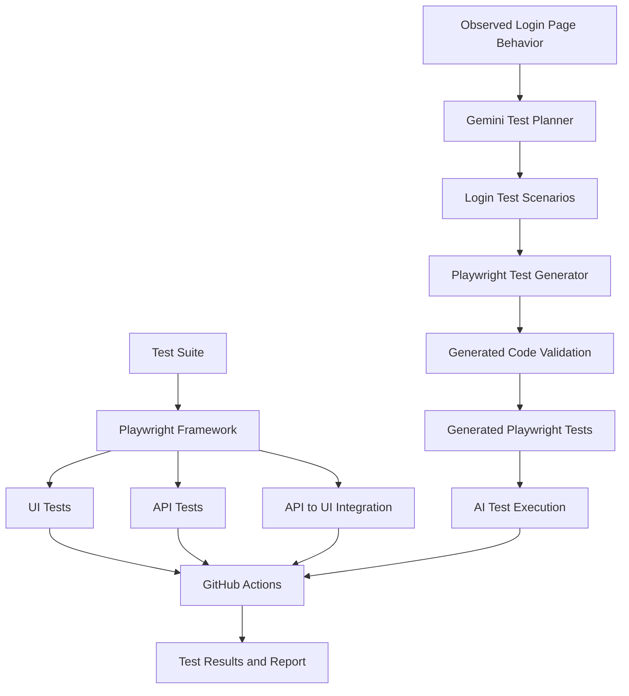

# AI-Enhanced Web & API Test Automation Framework

An end-to-end QA automation portfolio project combining **Playwright, TypeScript, API testing, GitHub Actions, and Google Gemini** to automate web application testing and generate additional Playwright tests using AI.

## Project Overview

This project automates selected UI and API workflows on [Automation Exercise](https://automationexercise.com), an e-commerce demo application.

It combines a reusable automation framework with an AI-assisted test-generation pipeline. The AI component creates test scenarios and generates Playwright code from observed login-page behavior. Generated code is validated before it is saved and executed.

## Key Features

* **UI automation:** Browser-based tests using Playwright and TypeScript.
* **Page Object Model:** Reusable page classes that separate page interactions from test logic.
* **API testing:** Reusable API client and API response validation.
* **API-to-UI integration:** Uses API product data to support UI validation.
* **Negative testing:** Covers selected invalid inputs and account-related scenarios.
* **AI-assisted test planning:** Google Gemini generates structured login test scenarios.
* **AI-generated test code:** Generates Playwright tests using observed page behavior and selectors.
* **Generated-code validation:** Performs static checks before saving generated test code.
* **CI/CD integration:** GitHub Actions runs the regular and AI-generated test suites.
* **Environment-based configuration:** Uses environment variables and GitHub Secrets for configuration and credentials.

## Technology Stack

| Area             | Technologies                                   |
| ---------------- | ---------------------------------------------- |
| Language         | TypeScript, JavaScript                         |
| UI automation    | Playwright                                     |
| API testing      | Playwright API capabilities, custom API client |
| Framework design | Page Object Model, reusable fixtures           |
| AI integration   | Google Gemini API                              |
| Code validation  | TypeScript compiler API and static checks      |
| CI/CD            | GitHub Actions                                 |
| Version control  | Git, GitHub                                    |
| Test application | Automation Exercise                            |

## Architecture



## How the AI Test-Generation Pipeline Works

1. **Observe:** Provide the AI planner with documented observations of the login page, including field selectors and known validation behavior.
2. **Plan:** Gemini produces structured test scenarios from the supplied observations.
3. **Generate:** The generator converts the plan into Playwright test code.
4. **Validate:** Static checks verify the generated code's syntax and enforce selected restrictions.
5. **Save:** The code is written to `tests/ai-generated/login.generated.spec.ts` only after validation passes.
6. **Execute:** Playwright runs the generated tests and reports the results.

The current login scenarios cover empty required fields, malformed email input, and invalid credentials.

**Important limitation:** The AI generator is not a complete security sandbox. Static validation reduces certain risks but cannot guarantee that generated code is safe or correct. Generated tests still require review and appropriate execution controls.

## Project Structure

```text
QA_Project1/
├── .github/
│   └── workflows/
│       └── playwright.yml
├── src/
│   ├── ai/
│   │   └── aiClient.ts
│   └── agents/
│       ├── plannerAgent.ts
│       ├── testGeneratorAgent.ts
│       └── loginObservation.ts
├── scripts/
│   └── generate-login-tests.ts
├── tests/
│   ├── api/
│   ├── api-ui-integration/
│   └── ai-generated/
│       └── login.generated.spec.ts
├── playwright.config.ts
├── package.json
└── .env.example
```

*The directory tree above summarizes the main project components; retain only paths that exist in the current repository.*

## Run Locally

### Prerequisites

* Node.js and npm
* Git
* A Google Gemini API key for AI test generation

### Install dependencies

```bash
npm ci
npx playwright install chromium
```

### Configure environment variables

Create a local `.env` file using `.env.example` as a reference. Configure the required base URL and test credentials.

Add your Gemini API key as `GEMINI_API_KEY` in the local `.env` file.

**Never commit `.env` or expose API keys and passwords in source code.**

### Run the regular test suite

```bash
npm test
```

### Generate and run AI-powered tests

```bash
npm run ai:test
```

The AI command generates the login tests and then runs the `ai-generated` Playwright project.

## Continuous Integration

GitHub Actions runs on pushes and pull requests targeting `main`.

The workflow:

1. Checks out the repository.
2. Installs Node.js dependencies.
3. Installs Chromium and its required dependencies.
4. Executes the regular Chromium test suite.
5. Generates and executes AI-powered tests using the `GEMINI_API_KEY` repository secret.
6. Uploads the Playwright report artifact.

AI generation requires a valid API key, network access, and available Gemini service capacity. Forked pull requests may not have access to repository secrets.

## Latest Verified CI Run

* Regular Chromium suite: **10 tests passed**
* AI-generated login suite: **3 tests passed**
* Generated-code validation: **passed**

These are results from a particular run, not a guarantee that every future run will pass. The local regular suite previously passed 13 tests; the difference between local and CI execution should be investigated if the counts remain different.

## What Makes This Project Different?

Unlike a framework that only executes manually authored tests, this project adds an LLM-assisted workflow that plans login scenarios and generates Playwright tests from supplied observations.

The combination of API/UI automation, reusable framework components, AI-assisted test generation, static validation, and CI execution demonstrates practical QA automation engineering skills.

## Future Improvements

* Add a browser-observation agent that collects page behavior and locator information.
* Add a test-execution analysis agent to summarize failures and likely causes.
* Explore controlled test repair suggestions with human approval.
* Expand API coverage and add schema and contract validation.
* Improve test reporting and attach AI-generated summaries to CI results.
* Add stronger isolation and security controls for generated code.

## Repository

[GitHub: agentic-qa-automation](https://github.com/Ganeshakaram/agentic-qa-automation)

## Author

**Akaram Ganesh**

Aspiring SDET | Playwright | Cypress | TypeScript | API Testing | AI-Assisted Test Automation
